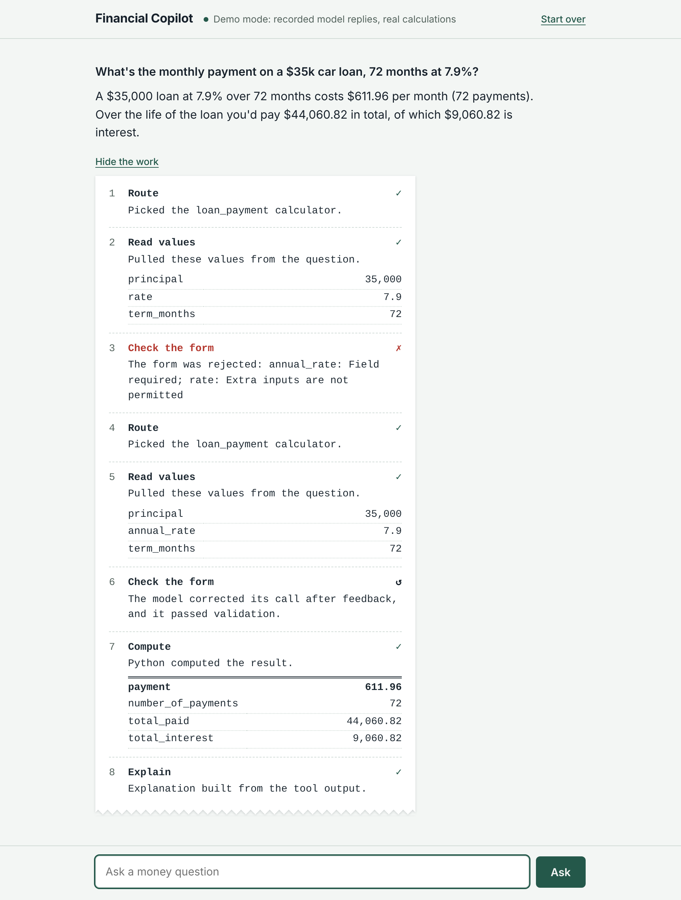

# Financial Copilot

A chatbot for money questions that never does the math itself. A fine-tuned **Llama 3.1 8B** reads the question, picks one of **38 financial calculators**, and fills in the numbers. **Pydantic** checks that form, **Python** computes the answer, and every number in the reply is verified against the calculator's output.



*Each answer prints its work: which calculator was picked, which values were read, whether the form passed validation (here the first try used a wrong field name, was rejected, and the model fixed it), and the exact result.*

---

## How it works

```
"If I invest $10,000 at 7% for 10 years, how much will I have?"
        │
        ▼
 1. ROUTE      Llama 3.1 8B (fine-tuned)  →  compound_interest
 2. EXTRACT    {"principal": 10000, "annual_rate": 7, "years": 10}
 3. VALIDATE   Pydantic form: right fields? right types? sensible ranges?
               ├─ rejected → error goes back to the model once so it can fix itself
               └─ value never given → ask the user instead of guessing
 4. CALCULATE  Python: 10000 × 1.07^10 = 19,671.51        (always exact)
 5. EXPLAIN    model writes the answer → grounding check: every number must
               come from the question or the result, otherwise use a template
        │
        ▼
"Investing $10,000 at 7% a year grows to $19,671.51 after 10 years..."
```

The model is the receptionist, not the accountant. Language models are good at understanding messy questions ("5 grand", "72 months", "my card is 24.99% APR compounded daily") and bad at arithmetic, so this project gives each job to the thing that's good at it.

## What's in the box

| Piece | Where | Status |
|---|---|---|
| 38 calculators with Pydantic schemas | `fincopilot/tools/` | Tested against textbook values, brute-force simulations and SciPy |
| Agent loop: route, validate, self-repair, clarify, grounding check | `fincopilot/agent.py` | Tested for every branch |
| Synthetic data generator: 7,780 training conversations | `fincopilot/datagen/` | Every label audited automatically |
| Held-out test set (1,092) + hand-written real-world set (94) | `data/` | Test phrasings never appear in training |
| QLoRA training script (Unsloth) | `training/train.py` | Data pipeline tested; the GPU step runs on Colab |
| Colab notebook: train, evaluate, export | `training/Financial_Copilot_Colab.ipynb` | |
| Evaluation harness: base vs fine-tuned report | `fincopilot/evaluation.py` | Tested with oracle and failing models |
| Web app + terminal chat | `fincopilot/web/`, `fincopilot/cli.py` | Works with Ollama, Hugging Face, any OpenAI-compatible server, or demo mode |
| Deployment: Modal (GPU that sleeps when idle) or Docker | `deploy/`, `Dockerfile`, [DEPLOY.md](DEPLOY.md) | Web app, rate limits and model client tested over HTTP; Modal script checked against the current Modal and vLLM sources |

116 automated tests cover all of the above: `python -m unittest discover -s tests -t .`

---

## Quick start (5 minutes, no GPU)

You need Python 3.10 or newer. Run these from the folder that contains `requirements.txt` (on Windows, "Extract All" often creates `financial-copilot\financial-copilot`, so use the inner folder).

```bash
cd financial-copilot
python -m venv .venv
source .venv/bin/activate            # Windows: .venv\Scripts\activate
pip install -r requirements.txt

python -m unittest discover -s tests -t .      # should end with: Ran 116 tests ... OK
python -m fincopilot.web --backend demo        # open http://127.0.0.1:7860
```

Keep that terminal open while you use the app; closing it or pressing Ctrl+C stops the server.

**Demo mode** replays recorded model replies for the six example questions so you can see the interface before installing a model. The calculations, validation and self-correction steps are all live.

---

## Step-by-step: building the whole thing

### Step 1. Understand the calculators

Every calculator is a Python function plus a Pydantic "form" describing its inputs. Open `fincopilot/tools/tvm.py` and find `compound_interest`:

```python
class CompoundInterestArgs(ToolArgs):
    principal: Number = arg("money", "the starting amount", "One-time amount invested today, in dollars.", gt=0, le=1e12)
    annual_rate: Number = _rate()                      # percent: 7 means 7%
    years: Number = _years()
    compounds_per_year: Integer = arg("freq", ..., 1, ge=1, le=365)
```

Try it directly:

```bash
python -c "from fincopilot.tools import get_tool; r = get_tool('compound_interest').run({'principal': 10000, 'annual_rate': 7, 'years': 10}); print(r.result); print(r.explanation)"
```

Two rules make the forms safe to hand to a language model:
- **`extra="forbid"`**: if the model invents a field name (`rate` instead of `annual_rate`), the form is rejected rather than silently ignoring it.
- **Both units where people mix them**: a car loan accepts `years` *or* `term_months`; income can be monthly *or* annual. The model copies what the user said and Python converts, so the model never does even "72 ÷ 12".

### Step 2. Run a real model on your laptop (the baseline)

Install [Ollama](https://ollama.com), then:

```bash
ollama pull llama3.1:8b                         # about 5 GB, needs 8 GB+ RAM
python -m fincopilot.web --backend ollama --model llama3.1:8b --prompt-style full
```

This is the **untuned** base model, given a long prompt that describes every tool (`--prompt-style full`). It's a real working assistant already, and it's your baseline to beat. Try the examples and some messy questions of your own, and watch the tape for rejected forms, wrong calculators or blocked plain-text math. Whatever it stumbles on is what fine-tuning should fix, and Step 5 measures exactly how much.

### Step 3. Generate and audit the training data

```bash
python -m fincopilot.datagen.generate --out data      # about 2 seconds, deterministic
python -m fincopilot.datagen.validate data            # checks every label
```

What you get (`data/stats.json`):

| Example type | Count | Teaches the model to... |
|---|---|---|
| tool | 6,080 | route and extract (160 per calculator, 7–12 phrasings each) |
| followup | 460 | ask for a missing value, then use the answer from the next message |
| clarify | 260 | ask instead of guessing when something is missing |
| repair | 240 | fix a rejected call after seeing the validation error |
| domain | 100 | explain impossible inputs (a payment too small to ever pay off a loan) |
| concept / advice / off-topic / greeting | 640 | answer without a tool, and decline stock picks and predictions |
| **total** | **7,780** | |

Each question's numbers are written the many ways people write them ("$10,000", "10k", "$10K", "10 grand", "ten thousand dollars"), with light noise (lowercase, missing punctuation, a typo). Open `data/train.jsonl` and read a few; every example is a full conversation in the exact format the model sees.

The validator re-runs every tool call, checks every one of the ~22,000 extracted values can actually be read from its question, and grounding-checks every explanation. It should print `OK`.

### Step 4. Fine-tune on Google Colab (free GPU)

1. Zip this folder (or push it to GitHub).
2. Open `training/Financial_Copilot_Colab.ipynb` in [Colab](https://colab.research.google.com) (File → Upload notebook).
3. Runtime → Change runtime type → **GPU**.
4. Run the cells top to bottom. The notebook installs Unsloth, runs the tests, regenerates and audits the data, shows you the tokenized loss mask, trains, and evaluates.

Training settings (`training/train.py`): QLoRA on the 4-bit model, LoRA rank 16 / alpha 32 on all attention and MLP projections, learning rate 2e-4 with cosine decay, 1 epoch, effective batch size 16 (about 490 steps). Checkpoints save to Google Drive, so if Colab disconnects you rerun with `--resume`.

What the model learns from: **only the assistant turns**. The system prompt, the user's words and the tool results are masked out of the loss. If the model were trained to predict tool results it would be learning to make up numbers, which is exactly what this project avoids. `python training/train.py --dry-run` prints an example with the learned spans marked so you can see this.

### Step 5. Evaluate (this is where your accuracy number comes from)

The notebook runs:

```bash
python -m fincopilot.evaluation --backend hf --adapter <your adapter> --compare-base --limit 400 --explain
```

and writes `reports/comparison.md`: the base model (adapter switched off, full prompt) versus your fine-tuned model (short prompt), on two test sets:

- **Held-out test set** (1,092 questions): built from phrasings that never appear in training, so it measures generalization, not memorization.
- **Real-world set** (94 questions): hand-written to be messy ("pe for a $42 stock earning $1.75 a share", "how long does 400k last if i take out 3k a month"). This is the most honest number.

Each question gets one model reply with no self-correction, so this measures the model itself. The metrics:

| Metric | Meaning |
|---|---|
| **Answer accuracy** | calculation questions where the model's call gives exactly the right result (equivalent forms like "72 months" vs "6 years" count) |
| Routing accuracy | picked the right calculator |
| Argument match | extracted values identical to the label |
| Valid tool calls | output parsed and passed the Pydantic form |
| Asked when info was missing | replied with a question instead of a guessed tool call |
| No tool when not needed | answered concept, advice and off-topic questions in plain text |
| Explanations passing the grounding check | every number in the model's explanation traces to the question or result |

### Step 6. Run your fine-tuned model locally

The notebook's export cell produces a ~5 GB GGUF file and an Ollama `Modelfile`. Download both into one folder, then:

```bash
ollama create fincopilot -f Modelfile
python -m fincopilot.web --backend ollama --model fincopilot
# or in the terminal:
python -m fincopilot.cli --backend ollama --model fincopilot
```

To compare locally against the base model with the same harness:

```bash
python -m fincopilot.evaluation --backend ollama --model llama3.1:8b --prompt-style full --name base
python -m fincopilot.evaluation --backend ollama --model fincopilot --name finetuned
python -m fincopilot.evaluation --compare reports/base.json reports/finetuned.json
```

### Step 7. Put it online

See **[DEPLOY.md](DEPLOY.md)**. The recommended route is one command on Modal: your fine-tuned model runs on a cloud GPU that sleeps when idle, behind a rate-limited public web app. The free plan's monthly credits are enough for a small public demo.

```bash
modal deploy deploy/modal_app.py
python deploy/smoke_test.py https://<your-workspace>--fincopilot-web.modal.run
```

---

## Results

Not measured yet. The first fine-tuning run will add them here: the evaluation harness (Step 5) compares the base and fine-tuned model on 1,092 held-out questions and 94 hand-written ones, one model reply per question with no retries.

## Design decisions

**Why route instead of letting the model calculate?** An LLM predicts plausible text; "$19,671.51" and "$19,617.51" look equally plausible to it. Code is exact. The model only has to do what it's good at: understanding the question.

**Why Pydantic?** It turns "the model's output looks right" into a checked contract: field names, types and ranges. A rejection is information, so it's fed back to the model once to self-correct (the `repair` training examples teach this). Only if the model still can't fill the form because the *user* never gave a value does the agent ask a clarifying question.

**Why mask the loss?** Training on tool results would teach the model to predict computed numbers, i.e. to hallucinate them. Masking everything except assistant turns means it learns *when and how to call tools* and *how to explain results it's shown*.

**Why a grounding check if the math is already exact?** Defense in depth. The model still writes the explanation, and it could paraphrase a number wrongly or add "you'll be done by 2036". The check reads every number in the reply; anything not traceable to the question or the calculator output (allowing honest rounding like "about $19.7k") causes a fallback to a template explanation built purely from code. The same check stops the model from answering a math question in plain text without calling a tool.

**Why two prompt styles?** The base model needs every tool described (~4,300 tokens) to have a fair chance. The fine-tuned model has learned the tools, so it gets one line per tool (~900 tokens), which is faster and cheaper on every request. That speedup is itself a benefit of fine-tuning.

**Why is the evaluation built the way it is?** Synthetic data makes it easy to fool yourself: a model can memorize templates and score 99% on more of the same. Here the test questions use held-out phrasings, the hand-written set uses none of the generator's machinery, and the scorer itself is tested (a perfect oracle must score 100%, a model that never calls tools must score 0%).

**Why identical prompt formatting everywhere?** `format_llama31()` builds the exact Llama 3.1 prompt for training, Hugging Face inference, Ollama (raw mode) and OpenAI-compatible servers. Mismatched chat templates between training and serving are a common silent failure.

---

## The 38 calculators

| Category | Calculators |
|---|---|
| **Time value of money** (10) | `compound_interest`, `simple_interest`, `future_value_with_contributions`, `present_value`, `present_value_of_annuity`, `continuous_compounding`, `effective_annual_rate`, `rule_of_72`, `years_to_goal`, `inflation_adjusted_value` |
| **Loans and mortgages** (7) | `loan_payment`, `mortgage_payment`, `remaining_loan_balance`, `loan_payoff_time`, `extra_payment_savings`, `max_affordable_loan`, `refinance_breakeven` |
| **Investing** (10) | `roi`, `cagr`, `npv`, `irr`, `payback_period`, `dividend_yield`, `pe_ratio`, `sharpe_ratio`, `average_cost_per_share`, `investment_fee_impact` |
| **Personal planning** (6) | `savings_goal_monthly`, `retirement_nest_egg`, `retirement_drawdown`, `emergency_fund`, `debt_to_income`, `budget_50_30_20` |
| **Business** (5) | `break_even_units`, `profit_margin`, `markup_percentage`, `straight_line_depreciation`, `percentage_change` |

## Project layout

```
fincopilot/
  tools/          calculators: base.py (registry, number parsing, Pydantic base), tvm.py, loans.py,
                  investing.py, planning.py, business.py, fmt.py (explanation formatting)
  prompts.py      system prompt, Llama 3.1 formatting, training-example tokenization + loss mask
  parsing.py      model text -> tool call or plain reply (tolerates code fences, single quotes...)
  grounding.py    the number-checking guard
  responses.py    clarification and error wording shared by training data and the live agent
  agent.py        the agent loop
  backends/       hf (Colab GPU), ollama, openai (llama.cpp / vLLM / LM Studio), demo, scripted (tests)
  datagen/        templates, samplers, number renderers, generator, validator, real-world test set
  evaluation.py   metrics, base-vs-fine-tuned reports
  cli.py, web/    terminal and browser chat
training/         train.py, export_gguf.py, Financial_Copilot_Colab.ipynb
deploy/           modal_app.py (Modal deployment), smoke_test.py (checks a live URL)
tests/            116 tests
data/             generated datasets (rebuild any time)
```

## Adding a calculator

1. Write the function and its `ToolArgs` form in the right `fincopilot/tools/*.py` file, decorated with `@register(...)`, including an `explain` function that only uses numbers from the inputs and result.
2. Add a sampler in `fincopilot/datagen/samplers.py` and templates (train, held-out test, partial) in `fincopilot/datagen/templates.py`.
3. Run the tests. They check the new tool's templates, that its explanations pass the grounding check, and that its labels can be read from the questions.
4. Regenerate the data and retrain.

## Troubleshooting

| Problem | Fix |
|---|---|
| `Can't reach Ollama at http://localhost:11434` | Start it with `ollama serve` (or open the Ollama app). |
| `Ollama has no model named ...` | `ollama list` shows what's installed; `ollama pull llama3.1:8b` or `ollama create fincopilot -f Modelfile`. |
| CUDA out of memory while training on a T4 | `--batch-size 1 --grad-accum 16` |
| CUDA out of memory while evaluating | `--batch-size 4` (the base model's long prompt uses more memory) |
| Colab disconnected mid-training | Rerun the setup cells, then the training cell with `--resume`. |
| Base model answers math in plain text | Expected sometimes. The grounding check blocks it and asks for a tool call; this is what fine-tuning fixes. |

## How this was built

Developed with help from an AI coding assistant. Every calculator, the agent loop, the data pipeline and the deployment code are covered by the automated tests above.

## License

MIT for this code. Llama 3.1 weights are covered by Meta's Llama 3.1 Community License.
